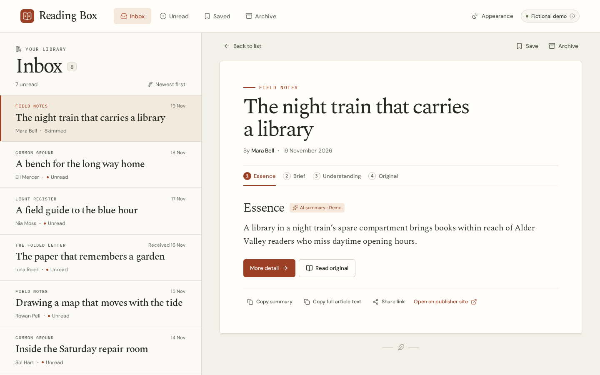

# Reading Box

A local-first reading PWA for Android and Windows. Phase 1 includes eight fictional articles and three deterministic summary depths. The fourth depth opens the original. Everything works without an account or an API key.

Phase 2 milestone 1 upgrades an existing library in place. [Windows setup and upgrade walkthrough](docs/LOCAL_LIBRARY_UPGRADE.md)



Choose **Appearance** in the header to switch between Light, Dark and System. On a phone, tap the sun-and-moon icon. System follows device changes automatically. The browser remembers your choice for future visits, including offline reading.

[Dark desktop reader](docs/preview/desktop-dark.png)

## Try the demo

Use Node.js 22.12 or newer and run these commands from the repository directory.

```sh
npm ci
npm run dev
```

Open the local address Vite prints, usually `http://localhost:5173`. The wide layout keeps the inbox beside the reader. A narrow window or phone opens the article on its own screen.

1. Open **The night train that carries a library**. Use **More detail** to move from one sentence to one paragraph, three paragraphs and the original. **Read original** skips ahead from any summary. The small book beside a list item goes straight to its original.
2. Try **Copy summary** and **Copy full article text** from the same summary stage. The latter includes the last paragraph. Save the article, archive it, then reopen it from Saved. Back returns to the list. The next open resumes the last depth and scroll position.
3. Expand **Reader discussion** beneath the original and open **View original comments**. The labelled demo publisher page works offline. Try the tide article for an excerpt or the Folded Letter newsletter for an article without a public link.
4. Select **Fictional demo** in the header to inspect the mock request counter. Opening the inbox or a complete Original makes zero requests. A new, supported summary depth is cached after its first successful request.

[Phone inbox](docs/preview/mobile-inbox.png) · [Phone reader](docs/preview/mobile-reader.png) · [Phase 1 verification and device checklist](docs/PHASE_1_REVIEW.md)

### Install or test offline

Build the production edition once and keep the preview server running.

```sh
npm run build
npm run preview -- --port 4173
```

To try a prebuilt copy, download **reading-box-preview** from the PR’s successful GitHub Actions run and extract the ZIP. With Python 3 installed, open a terminal in the extracted folder and run `py -m http.server 4173 --bind 127.0.0.1` on Windows, or `python3 -m http.server 4173 --bind 127.0.0.1` on macOS or Linux. Open `http://localhost:4173`.

On **Windows**, open `http://localhost:4173` in Edge or Chrome. Use the browser’s install-app command. After the first online load, the service worker caches the shell, bundled fonts, article assets and local mock inputs. Reload once before disconnecting. The installed app can reopen offline and serve previously unrequested fixture depths.

On **Android**, use Chrome with trusted HTTPS or device loopback. For a USB-connected test phone with Android platform tools and USB debugging enabled, run `adb reverse tcp:4173 tcp:4173` on the computer and open `http://localhost:4173` on the phone. Chrome’s menu offers installation on supported devices. An ordinary HTTP LAN address lacks the secure context required for the PWA and Web Crypto. Each browser profile keeps its own reading state. To keep an existing library when updating to Reading Box, open it with the same browser profile, host and port. Close all old app windows and reopen to activate a waiting service-worker update. The browser or OS controls the installed app’s launch screen and the timing of an updated installation name.

## Data boundaries and limitations

- The fixture adapter supports RSS-style deliveries with GUIDs and plain-text newsletters with Message-IDs. Publication date falls back to a labelled received date. Complete, excerpt and unavailable bodies have distinct presentation and copy controls.
- Dexie stores the articles, independent saved/archive flags, reading depth, scroll offsets and generated summaries in IndexedDB. A source edit retains the article ID and flags. Successful summaries use a key containing the local reader scope, article, body hash, coverage, stage, model and prompt versions.
- The mock reads authored responses from same-origin demo assets on demand. No article is submitted to an external model. Browser storage can be cleared or evicted. There is no account, remote sync, analytics or backup in this milestone.
- All demo publishers and discussion destinations are fictional. The post and discussion links stay within the local demo. Browser sharing hands the selected publisher URL to the device share sheet or copies it. A localhost link resolves on the receiving device only if it is running the same demo.
- Live feeds, extraction, subscription management, search, additional filters, bulk operations and export are deferred to Phase 2. External AI requires separate provider and budget approval. Recommendations, sync and authorised discussion analysis belong to later milestones. [Approved plan](IMPLEMENTATION_PLAN.md)

The approved Phase 2 plan describes the first real-feed preview at milestone 3 and the separate decision about paid summaries. [Read the Phase 2 technical plan](docs/PHASE_2_PLAN.md)

## Verification

```sh
npm ci
npm run format:check
npm run lint
npm run typecheck
npm run test:unit
npm run build
npx playwright install chromium
npm run test:e2e
```

Playwright builds and serves its own production preview on port 4180. The default projects cover a desktop viewport and a touch-enabled Pixel 7 viewport. Set `READER_BROWSER_CHANNEL` to `chrome` or `msedge` and use `npm run test:e2e -- --project=desktop` to exercise an installed desktop browser.

The PR checks also run on Windows Edge and Chrome and tap through the reader on an Android 15 emulator. The Android check uses the emulator SDK’s bundled Chrome and a loopback connection to the built app.

The original application and fixtures use the repository’s MIT licence. Vite includes third-party package and bundled font notices in the production build.
